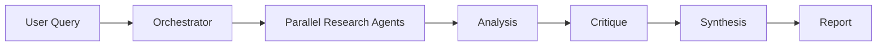

# Multi-Agent Research System

A LangGraph research pipeline that fans out web research, critiques its analysis, and streams a cited report over FastAPI.

[](https://github.com/mariamneffeti/Multi_Agent_Search_System/actions/workflows/ci.yml)


[](https://multi-agent-search-system.onrender.com)

## Live Interactive Demo

Try the interactive research agent live in production:

🔗 **[Open Nexus Research Live Demo](https://multi-agent-search-system.onrender.com)**

*Decomposes queries into subtasks, conducts parallel Tavily web searches, and streams synthesis and critique via Server-Sent Events (SSE).*

## Features

- Orchestrator breaks a query into focused, searchable subtasks.
- Parallel research mode dispatches one research worker per subtask with LangGraph `Send()`.
- Analysis organizes findings and evidence; a critique agent identifies gaps and unsupported claims.
- Synthesizer produces a structured report with references and limitations.
- FastAPI streams progress and the final report to clients using Server-Sent Events.
- LangGraph supports `interrupt_before` and checkpointed thread state when a checkpointer is configured; see [Human review](#human-review).
- A shared LangChain rate limiter controls model request pace.

## Architecture



## Stack

Python 3.11, LangGraph, LangChain, FastAPI, Docker, Groq (Llama 3.3) for language model calls, and Tavily for web search.

## Quickstart

### Docker

```bash
cp .env.example .env
# Set GROQ_API_KEY and TAVILY_API_KEY in .env
docker compose up --build
```

Open `http://localhost:8000`. The service listens on port 8000.

### Manual

```bash
python -m venv .venv
source .venv/bin/activate  # Windows: .venv\Scripts\activate
pip install -r requirements.txt
cp .env.example .env       # Add your keys to .env
uvicorn api:app --reload --port 8000
```

For a command-line report, run `python main.py "Your research question" --parallel`.

## API

| Method | Path | Purpose |
| --- | --- | --- |
| `GET` | `/` | Serves the research interface. |
| `GET` | `/history` | Serves the history page. |
| `GET` | `/about` | Serves the about page. |
| `GET` | `/api/health` | Reports service status and whether provider keys are configured. |
| `POST` | `/research` | Starts research and streams status, then a `done` event with report, flags, citations, and subtasks. Body: `{"query":"...","parallel":true}`. |

## Configuration

Copy `.env.example` to `.env` and provide:

| Variable | Purpose |
| --- | --- |
| `GROQ_API_KEY` | Groq chat model access. |
| `TAVILY_API_KEY` | Tavily web search access. |

Keep `.env` local; it is ignored by Git.

## Testing

Install the development dependencies with `pip install -r requirements-dev.txt`, then run `pytest`. GitHub Actions runs the test suite on pushes and pull requests.

## Project structure

| Path | Responsibility |
| --- | --- |
| `api.py` | FastAPI routes and SSE research endpoint. |
| `agents.py` | Orchestrator, research, analysis, critique, and synthesis nodes. |
| `state.py` | Shared Pydantic graph state and list reducers. |
| `graph.py` | Sequential LangGraph workflow. |
| `parallel_graph.py` | Parallel research workflow using `Send()`. |
| `tools.py` | Tavily search and HTTP page fetch tools. |
| `main.py` | Command-line entry point. |
| `static/` | HTML pages served by the API. |
| `tests/` | Automated tests with mocked external calls. |
| `.github/workflows/` | CI and deployment workflows. |

## Key technical decisions

- **LangGraph** models the pipeline as explicit stateful nodes and edges, which makes execution and checkpointing inspectable.
- **`Send()` and `operator.add` reducers** fan out one research task per worker and merge each worker's research results and sources into shared state.
- **`interrupt_before`** provides a review point before synthesis. The application can resume a checkpoint after a person approves or edits state.
- **Rate limiting** spaces shared Groq model requests to reduce bursts against provider limits. The current limiter is in-memory and process-local.

### Human review

The graph definitions can be compiled with `interrupt_before=["synthesizer"]` and a LangGraph checkpointer. Invoke with a stable `thread_id`, inspect or update the checkpointed state, then resume the same thread. The default API and CLI do not enable review or persistent storage; choose and configure a durable checkpointer before relying on state across restarts.

## Core Pipeline Capabilities

- **Subtask Decomposition:** Breaks complex multi-hop research topics into discrete, focused queries.
- **Concurrent Retrieval:** Dispatches parallel research workers via LangGraph Send() with operator.add accumulation.
- **Critical Synthesis:** Dedicated critique agent audits findings for bias, coverage gaps, and unsupported assertions before final synthesis.
- **Streaming Output:** Streams live research progress and cited markdown reports over FastAPI Server-Sent Events.

## Roadmap

- Add representative demo media and measured end-to-end results.
- Add durable checkpoint configuration for long-running, reviewable research threads.
- Improve observability for agent steps, provider latency, and token usage.

## Deployment

The repository's Render deployment is currently inactive. To reactivate it, create or select the Render service, configure `GROQ_API_KEY` and `TAVILY_API_KEY` in that service, add its deploy hook URL as the GitHub Actions secret `RENDER_DEPLOY_HOOK`, and push to `main`. The existing workflow builds and publishes the container to GHCR, then calls the hook when the secret is present. Confirm the service's image and port settings in Render before relying on automated deploys; the hook does not create or configure the service.

## License

MIT. See [LICENSE](LICENSE).

## Contact

**Meriem Neffeti**  
AI Automation Engineer  
Email: [neffetimeriem@gmail.com](mailto:neffetimeriem@gmail.com) · [LinkedIn](https://www.linkedin.com/in/meriem-neffeti-8a488a385/) · [GitHub](https://github.com/mariamneffeti)
